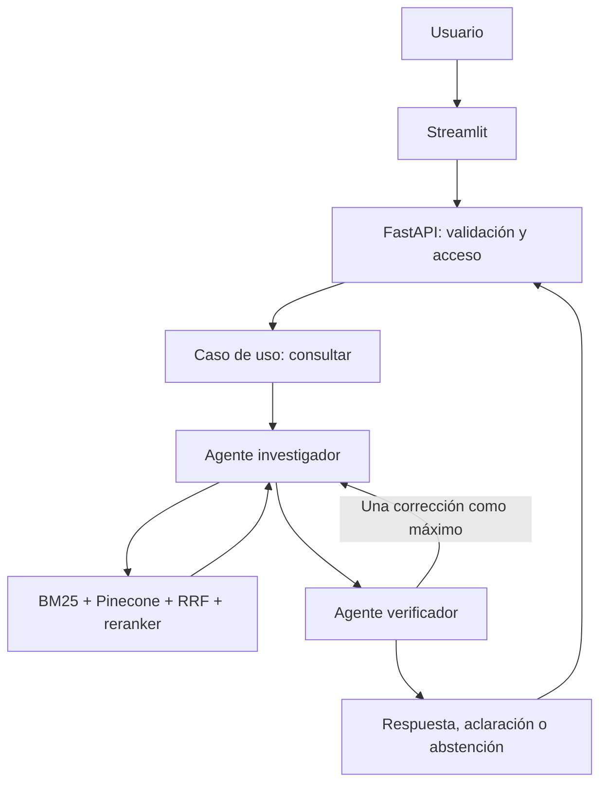
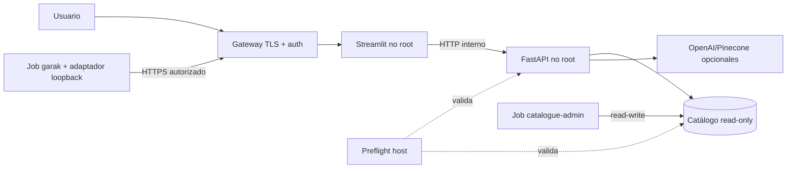

# Arquitectura propuesta

## Objetivo y estilo

Monolito modular de backend con puertos y adaptadores, frontend Python separado por HTTP. Los
módulos no se convierten en microservicios. V1 ejecuta FastAPI y Streamlit localmente; V2 empaqueta
API/UI como procesos separados, añade gateway y jobs explícitos con Docker Compose. SQLite mantiene
el catálogo versionado; Pinecone almacena vectores opcionales. Una réplica backend simplifica
recursos, caché y límites. Engram y OpenSpec pertenecen al plano de desarrollo.

## Despliegue V2

ADR-015 define una PoC productiva single-host. Sólo gateway publica 80/443; UI consume API por DNS
Compose y API monta el catálogo read-only. `catalogue-admin` escribe el volumen únicamente en una
operación explícita. Imágenes y configuración no contienen secretos; producción usa archivos
montados por servicio. Garak es un job separado de release/staging y no una dependencia runtime.
Su contenedor no recibe credenciales de proveedor: un adaptador loopback traduce el contrato REST
de Garak a `/v1/query`, agrega Basic auth y reader key desde archivos distintos, y sólo acepta un
target HTTPS explícito. El gateway enruta `/v1/*` a API bajo la misma autenticación de ingreso.
El runner se construye, genera SBOM, reescanea y publica una sola vez por SHA mediante un workflow
manual separado. Otro workflow manual, protegido por el environment `staging-security`, acepta
exclusivamente ese paquete por digest, exige autorización y secretos de ensayo, cifra el reporte
crudo antes de conservarlo y publica por separado el resumen sanitizado.
El gateway expone `/health/*` hacia API bajo la misma autenticación global, de modo que la
verificación externa pueda comparar `/health/version` con el manifiesto sin publicar API. El smoke
de staging descarga el manifiesto producido por supply chain, rechaza tags/paquetes ajenos y sólo
conserva identidad, conteos y estado de una consulta; no conserva pregunta, respuesta ni secretos.

La API recibe identidad de release por entorno (`AGRO_RELEASE_VERSION`, `AGRO_COMMIT_SHA` y
`AGRO_IMAGE_DIGEST`), la publica en `/health/version` junto con el catálogo activo y emite un evento
JSON sanitizado por request. Readiness continúa autenticada y valida corpus/proveedor; liveness no
depende de red. La referencia observable no sustituye la verificación del digest en el manifiesto de
Compose ni la evidencia de promoción. API, UI y gateway llevan la misma revisión/versión OCI; CI y
el preflight rechazan cualquiera de los tres artefactos si su label no coincide con la candidata.

El backup de catálogo es un artefacto autocontenido con hashes: manifiesto activo, único snapshot
referenciado y metadata de release. Restore verifica todo antes de escribir, conserva snapshots ya
presentes y activa el puntero en último lugar. El rollback combina ese restore con los tres digests
anteriores conservados por release; no reconstruye corpus durante startup ni elimina el volumen.
En un host limpio, el operador crea y restaura explícitamente el volumen externo antes del runtime.
Un preflight fail-closed y read-only comprueba Linux, Engine/Compose, imágenes locales por digest,
commit OCI, usuarios no root, volumen y permisos de archivos secretos antes de permitir `up`; al
aprobar emite inventario sanitizado de recursos, tiempos y digests para la evidencia de staging.

El overlay local comprueba liveness para permitir exploración BM25; el productivo exige readiness
autenticada y proveedor completo. Filesystems son read-only salvo tmpfs/volúmenes declarados. Ver
`docs/run-containerized.md`, ADR-015 y OpenSpec 07 para estado y límites.

## Dependencias permitidas

- domain: Python estándar y tipos propios. Entidades inmutables para evidencia y resultado.
- application: domain y Protocols de retrieval, generador, auditoría, reloj y presupuesto.
- infrastructure: implementa esos puertos; encapsula SDKs, LangGraph, almacenamiento y embeddings.
- api: application + DTO Pydantic; obtiene casos de uso desde bootstrap. No lógica agronómica en rutas.
- bootstrap: único lugar que ensambla adaptadores, settings y ciclo de vida de modelos.
- agro_rag_ui: cliente HTTP propio, modelos de vista y Streamlit; no importa agro_rag. El contrato HTTP y sus fixtures se verifican mediante tests, sin compartir lógica de negocio.
- infrastructure nunca importa api/UI; application nunca importa infrastructure. Los contratos se verifican con import-linter o tests de AST; no se resuelven ciclos con imports locales ocultos.

## Ingesta offline

Fuentes admitidas → extracción por página → revisión de tablas → normalización conservadora → chunks → catálogo SQLite + BM25 → embeddings → namespace Pinecone nuevo → verificación de conteos/IDs/textos → activación atómica del manifiesto local.
Una ingesta fallida conserva el corpus activo anterior. Los namespaces no se reutilizan entre versiones. Nada se reindexa durante una consulta. No ejecutar clear_namespace sobre datos activos. corpus_version deriva del manifiesto con hashes, configuración y modelos; no depende sólo del nombre del archivo.

## Consulta y agentes de aplicación

El investigador recibe pregunta/contexto, decide aclarar o buscar, puede reformular hasta dos subconsultas dentro del presupuesto y redacta claims con evidence_ids. El verificador tiene acceso de lectura a pasajes originales y puede llamar a una búsqueda focalizada para contrastar. Emite un resultado estructurado: approve, revise, clarify o abstain, con incidencias breves y evidencia. No guardar razonamiento privado extenso.

La primera revisión puede solicitar corrección; la segunda termina en respuesta aprobada, aclaración o abstención. Máximo dos pasadas de investigación y dos de verificación, seis llamadas LLM totales y cuatro operaciones de búsqueda totales. Los límites de cantidad, tokens y deadline son compartidos por toda la petición, incluidas herramientas y reintentos. Las decisiones son dinámicas; no basta concatenar dos prompts sin permitir corrección.

## Estados y salida

Estados públicos de negocio: answered, needs_clarification, insufficient_evidence. Fallos operativos usan errores HTTP tipados; no se convierten en abstención agronómica ni respuesta exitosa. Toda respuesta answered tiene claims respaldados por evidence_ids existentes y citas direccionables; la verificación semántica se mide, no se presume infalible.

## Ejecución y recursos

Modelos se cargan una vez en startup; cerrar clientes en shutdown. Tareas CPU/SDK síncronos van a workers limitados, sin bloquear el event loop. Límite inicial dos consultas activas, cola explícita inexistente: exceso 429. Reintentos sólo de errores transitorios, máximo uno por operación y dentro del deadline; jitter y reloj reemplazables en tests. Startup no crea o borra índices automáticamente.

Objetivos iniciales a medir, no resultados: p95 caliente ≤30 s en demo local y timeout global 60 s. Presupuesto máximo 12.000 tokens acumulados de entrada y salida por consulta; si un proveedor no devuelve usage, registrar estimación diferenciada. Ajustes pasan por configuración y evaluación en dev.

## Datos y observabilidad

Request ID, corpus_version, commit, prompt_version, modelo, etapas, duración, llamadas, tokens reales/estimados, caché y causa de cierre. No guardar texto completo de preguntas por defecto ni secretos. Citas guardan página física PDF y etiqueta impresa separadas. Caché de retrieval por consulta normalizada, filtros, corpus_version, modelo y parámetros; no cachear errores ni compartir resultados entre corpus distintos.

Ver docs/contracts.md, docs/security.md y ADR-003 a ADR-010.
