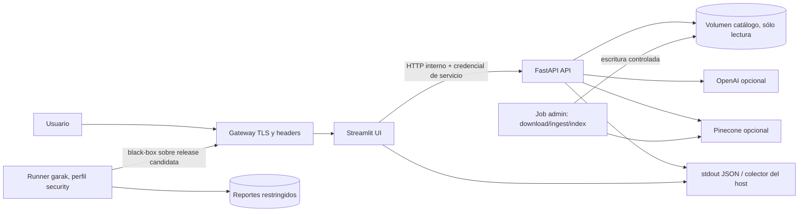

# Plan V2: PoC containerizada y desplegable en un único host

Estado: aceptado y en ejecución. Fecha: 29/10/2026. Responsable: coordinador de arquitectura.
Rama de implementación inicial: `feat/v2-container-foundation`. Propiedad de esta etapa:
configuración/entrypoints, infraestructura de contenedores, pruebas, OpenSpec, documentación y
evidencia V2. ADR-015 fue aceptado por Gustavo Julián Rivas el 29/10/2026.

## Objetivo

Evolucionar AgroRAG V1 hacia una V2 que se construya, pruebe y ejecute íntegramente con imágenes
OCI y Docker Compose, y que pueda desplegarse como PoC en un único host Linux sin instalar Python,
uv ni dependencias del proyecto en el anfitrión.

“Desplegable en producción” significa en esta etapa: imágenes inmutables, configuración externa,
secretos fuera de la imagen, procesos no root, estado persistente explícito, healthchecks, límites de
recursos, logs estructurados, CI de contenedores y rollback reproducible. No significa alta
disponibilidad, escalado horizontal, multitenancy ni cumplimiento regulatorio.

La V2 incorpora garak como evaluación adversarial reproducible del sistema desplegado. Es una
fuente de evidencia y una compuerta de release, no una garantía de seguridad, certificación ni
cobertura completa de OWASP u otro estándar.

Decisión arquitectónica: [ADR-015](adr/015.md).
Contrato de implementación: [OpenSpec 07](../openspec/changes/07-containerized-production-poc/).

## Estado de partida y restricciones

- FastAPI y Streamlit ya son procesos separados; la UI consume la API únicamente por HTTP.
- `bootstrap` ensambla catálogo, retrieval, proveedor generativo y auditoría. No se mueve lógica de
  negocio a Docker, Compose ni al gateway.
- El catálogo activo es un snapshot SQLite versionado en `data/processed/catalogue`; API y UI no
  deben descargar corpus, construir índices ni mutar el snapshot durante startup.
- OpenAI y Pinecone son servicios externos. Ollama queda como perfil local opcional y no forma
  parte del camino productivo por defecto.
- El caché de retrieval es local a una instancia de `QueryService`. V2 mantiene una réplica de API;
  Redis y el escalado horizontal requieren una decisión posterior.
- BM25 continúa como modo productivo inicial. Los modos semánticos sólo se habilitan con identidad,
  modelos y namespace compatibles, sin fallback silencioso.
- ADR-003/004/006/013/014 y los contratos de importación actuales siguen vigentes.

## Arquitectura objetivo

### Unidades de despliegue

| Unidad | Responsabilidad | Exposición y estado |
|---|---|---|
| `gateway` | TLS, routing, límites HTTP y headers de seguridad. | Único servicio con puertos publicados en producción. La identidad de usuario se delega al ingress/IdP del ambiente. |
| `ui` | Streamlit y cliente HTTP. | Red interna; no conoce SDKs backend ni claves OpenAI/Pinecone. |
| `api` | FastAPI, catálogo, retrieval, agentes y proveedores. | Red interna; una réplica en V2. Catálogo montado read-only. |
| `catalogue-admin` | Descarga, ingesta e indexación explícitas. | Job one-shot bajo perfil `admin`; volumen read-write. Nunca arranca con el runtime. |
| `ollama` | Generación local para desarrollo/demos. | Perfil `local-model`; ausente del overlay productivo por defecto. |
| `garak` | Pruebas adversariales black-box de la experiencia desplegada. | Job one-shot del perfil `security`; se ejecuta en staging/release candidate, nunca como servicio de runtime. |

### Archivos objetivo

- `Dockerfile`: etapas reutilizables de build y targets finales `api` y `ui`.
- `.dockerignore`: excluye `.git`, `.env`, caches, outputs, corpus descargado y artefactos locales.
- `compose.yaml`: contrato base de servicios, redes, volúmenes y healthchecks.
- `compose.dev.yaml`: puertos locales y opciones de desarrollo, sin redefinir el contrato base.
- `compose.production.yaml`: imágenes de registry por digest/tag inmutable, gateway, políticas de
  restart, recursos, filesystem read-only y logging.
- `compose.security.yaml`: runner garak aislado, sin puertos publicados y con salida a un volumen de
  reportes; apunta al gateway de staging, no directamente al modelo.
- `Dockerfile.garak` e `infra/garak/`: versión fijada, adaptador HTTP AgroRAG, selección de probes,
  baseline y política de evaluación. Sus dependencias no entran en las imágenes API/UI.
- `infra/gateway/`: configuración versionada sin certificados ni secretos.
- `docs/run-containerized.md`: build, administración del catálogo, despliegue, backup y rollback.

Docker recomienda separar los ajustes productivos mediante un archivo Compose adicional, evitar
bind mounts de código en producción y usar imágenes multi-stage y usuario no root. Compose monta
secretos sólo en los servicios autorizados; la aplicación adoptará variables `*_FILE` para leerlos.

## Contratos de arquitectura

1. Docker y Compose sólo ensamblan procesos; `domain` y `application` no importan APIs de
   contenedores, archivos de infraestructura ni frameworks.
2. `ui` llama a `http://api:8000` en la red interna. No importa `agro_rag` ni comparte SQLite.
3. `api` falla cerrado si falta catálogo, credencial requerida, proveedor o identidad semántica.
4. Startup no descarga documentos, pesos ni crea namespaces. Esas operaciones pertenecen al job
   `catalogue-admin` o al pipeline de imagen.
5. El catálogo se publica atómicamente y se monta read-only en `api`; sólo el job administrativo
   recibe acceso de escritura.
6. La API no se publica al host en producción. La reader key se convierte en credencial interna
   UI→API, no en identidad de usuario final.
7. Secretos no se aceptan como `ARG`, `ENV` de imagen ni valores versionados. Se montan desde el
   secret store del ambiente y se leen desde `/run/secrets/...`.
8. Imágenes finales ejecutan como UID/GID no root, con `read_only`, `tmpfs` para temporales,
   `cap_drop: [ALL]` y `no-new-privileges` donde el runtime lo permita.
9. Logs operativos salen por stdout/stderr en JSON sin pregunta, prompts, pasajes ni secretos.
10. Cada imagen expone versión de aplicación, commit y digest; el despliegue y rollback usan una
    referencia inmutable, nunca `latest`.
11. Garak prueba la release candidata por el gateway con un usuario de ensayo y datos sintéticos.
    Su credencial no se registra y los reportes crudos, que contienen prompts y respuestas, son
    artefactos restringidos con retención definida.
12. La seguridad generativa se decide por hallazgos y regresiones por probe/detector, no por un
    promedio global. Todo hallazgo aceptado documenta riesgo, responsable, vencimiento y control.

## Plan de implementación TDD

Cada corte se integra por separado. Las tareas funcionales se abren en OpenSpec después de aceptar
ADR-015. Los tests de contenedor no consultan LLMs pagos ni descargan pesos.

Estado al 29/10/2026 en MR #30: contrato y CFG-V2-01 completos; imágenes API/UI/gateway construidas
como no root; Compose local, catálogo persistente/read-only y overlay productivo endurecido
implementados. Permanecen abiertos ARC-V2-02 final, browser E2E Compose, logs/release, rollback,
CI/SBOM/escaneo, staging y garak. Ninguna fase abierta se considera satisfecha por la documentación.

### Fase 0 — contrato de V2

**ARC-V2-01.** Aceptar ADR-015, crear el cambio OpenSpec y fijar Definition of Done, propietario,
archivos y riesgos. No hay RED de producto porque esta fase sólo decide arquitectura.

Salida: ADR y plan aceptados; nombre de registry, dominio/ingress, host Linux y secret store del
ambiente identificados.

### Fase 1 — configuración y entrypoints container-safe

**CFG-V2-01.** RED: tests de settings demuestran que secretos por archivo, rutas absolutas internas
y URL `api` aún no están soportados. GREEN: agregar resolución `*_FILE`, validación fail-closed y
entrypoints API/UI/healthcheck sin shell. REFACTOR: typing, redacción y compatibilidad local.

**ARC-V2-02.** RED: contratos detectan importaciones indebidas y escritura del runtime en el
catálogo. GREEN: separar explícitamente configuración runtime/admin sin mover negocio de capa.

Puerta: V1 sigue ejecutable localmente; ninguna clave aparece en `repr`, logs o excepciones.

### Fase 2 — imágenes reproducibles

**IMG-V2-01.** RED: prueba de imagen exige Python 3.12, wheel instalado, usuario no root, ausencia
de toolchain/dev deps y labels OCI. GREEN: Dockerfile multi-stage con targets `api` y `ui`.

**IMG-V2-02.** RED: inspección detecta `.env`, `.git`, outputs o corpus local en el contexto/imagen.
GREEN: `.dockerignore`, copies acotadas y build sin secretos.

Puerta: build reproducible por lockfile, arranque como no root y escaneo sin vulnerabilidades
críticas no exceptuadas.

### Fase 3 — Compose local y ciclo del catálogo

**CMP-V2-01.** RED: `docker compose config`/smoke muestran ausencia de red, healthchecks y
dependencias. GREEN: `api`, `ui`, volumen y red interna; `docker compose up --wait` llega a healthy.

**DAT-V2-01.** RED: reiniciar contenedores pierde o permite mutar el catálogo. GREEN: job
`catalogue-admin`, publicación atómica, volumen persistente y montaje read-only del runtime.

**CMP-V2-02.** RED: E2E desde un checkout sin Python no puede consultar UI/API. GREEN: recorrido
real con corpus fixture, reinicio y segunda consulta; sin servicios pagos.

Puerta: `down`/`up` conserva catálogo, `down -v` es la única operación que lo elimina y el runbook
incluye advertencia y backup previo.

### Fase 4 — overlay productivo y seguridad

**SEC-V2-01.** RED: API o puertos internos quedan expuestos, filesystem es escribible o un servicio
recibe secretos ajenos. GREEN: gateway único, redes segmentadas, secretos por servicio, read-only,
capabilities y límites.

**OPS-V2-01.** RED: readiness acepta proceso sin catálogo/modelo y los logs no identifican release.
GREEN: healthcheck container-local, labels/versiones, request ID y logging estructurado.

**OPS-V2-02.** RED: corte durante deploy no tiene rollback verificable. GREEN: deploy por digest,
backup del catálogo y comando documentado para volver a la imagen/manifiesto anterior.

Puerta: revisión de amenazas, prueba de secreto centinela y prueba de recuperación aprobadas.

### Fase 5 — CI, registry y staging

**CI-V2-01.** BuildKit construye ambos targets, ejecuta tests dentro de imágenes, valida Compose,
genera SBOM, escanea imagen y publica sólo desde `main`/tag con tags SHA y semver.

**REL-V2-01.** Desplegar en staging Linux limpio, ejecutar smoke/E2E, reinicio, backup/restore y
rollback. Registrar host/CPU/memoria, imágenes, digests, tiempos y evidencia.

**REL-V2-02.** Promover la misma imagen aprobada a la PoC productiva; no reconstruir entre staging
y producción.

**SEC-V2-02.** RED: tests del adaptador y de política demuestran que aún no se puede evaluar
`/v1/query` ni convertir un reporte garak en una decisión reproducible. GREEN: imagen garak fijada,
adaptador black-box al gateway, configuración versionada y parser/gate. REFACTOR: separar secretos,
reportes crudos y resumen sanitizado.

La suite inicial cubre riesgos priorizados para AgroRAG: prompt injection, jailbreak, bypass por
codificación, fuga de información y contenido inseguro. Se fijan versión, plugins, configuración,
seed, cantidad de generaciones, modelo/proveedor y digest de la aplicación. Los nombres exactos de
probes/detectors quedan fijados en OpenSpec contra una versión concreta de garak para evitar drift.

En cada PR se prueban offline el adaptador, la configuración y la política. El scan acotado corre
contra staging; el scan completo corre para release candidate y periódicamente. La promoción se
bloquea si aparece un hallazgo crítico/alto confirmado sin excepción vigente o si un
probe/detector supera la tolerancia de regresión acordada respecto del baseline. La revisión humana
resuelve falsos positivos y confirma materialidad; un resultado sin hits no demuestra ausencia del
riesgo.

Puerta final: los criterios siguientes están demostrados y no sólo documentados.

## Criterios de aceptación de V2

- Un host Linux limpio con Docker Engine y Compose Plugin puede desplegar la aplicación siguiendo
  el runbook, sin Python/uv del proyecto.
- `docker compose -f compose.yaml -f compose.production.yaml config` no contiene secretos en
  claro ni bind mounts de código.
- Sólo el gateway publica puertos; API, UI, volumen y jobs viven en redes/alcances mínimos.
- Liveness, readiness y UI funcionan; UI→API usa DNS interno y credencial de servicio.
- Contenedores corren no root, con filesystem read-only salvo volúmenes/tmpfs declarados.
- Reiniciar/recrear `api` y `ui` conserva el catálogo; una versión incompatible falla cerrada.
- El job administrativo es idempotente, no se ejecuta en startup y no sobrescribe una versión
  activa hasta terminar validaciones.
- Suite offline, E2E Compose, Ruff, mypy, import-linter, OpenSpec, escaneo de secretos e imágenes
  aprueban en CI.
- La release candidate tiene reporte garak JSONL, digest HTML/AVID o equivalente, resumen
  sanitizado, versiones/configuración y dictamen trazable. No hay hallazgos críticos/altos
  confirmados abiertos ni regresiones fuera de tolerancia.
- La imagen desplegada tiene digest, commit, SBOM y procedimiento de rollback probado.
- El gateway/ingress productivo autentica usuarios o restringe acceso; no se publica una UI anónima
  con una API key compartida como único control.

## Fuera de alcance de esta V2

- Kubernetes, Swarm, service mesh, autoscaling y despliegue multi-región.
- Más de una réplica de API, cero downtime garantizado y cache distribuida.
- Multiusuario con roles, historial de conversaciones o datos privados.
- PostgreSQL, colas de tareas y migración del catálogo SQLite a una base transaccional.
- Descargar modelos o construir índices durante startup.
- Activar `hybrid_rerank` como default sin nueva evidencia de calidad/latencia.

## Riesgos y mitigaciones

| Riesgo | Mitigación / decisión |
|---|---|
| Imagen semántica grande o sin pesos locales | BM25+OpenAI como perfil inicial; modelos en artefacto/cache explícito, nunca descarga en startup. |
| SQLite en volumen compartido | Una réplica de API y montaje read-only; escrituras sólo en job administrativo. |
| Reader key confundida con identidad | Tratarla como secreto servicio-a-servicio; autenticación de usuario en ingress/IdP. |
| Compose interpretado como HA | Declarar SLO y límites de single-host; nuevo ADR antes de escalar. |
| Secretos filtrados por Compose/CI | Secret files, logs redactados, escaneo centinela y sin `ARG`/`ENV` de build. |
| Diferencia dev/prod | Compose base común y overlays mínimos; misma imagen por digest en CI, staging y prod. |
| Host sin recursos para reranker/Ollama | Perfiles opcionales y límites de recursos; proveedor externo en el camino productivo. |
| Garak produce falsos positivos/negativos o resultados variables | Probes priorizados, configuración/seed/versiones fijadas, baseline por detector, repetición y triage humano; no presentarlo como certificación. |
| El reporte adversarial filtra prompts, respuestas o credenciales | Datos sintéticos, cuenta aislada, artefacto cifrado/restringido, retención corta y resumen sanitizado. |
| Scan adversarial consume tiempo o APIs pagas | Suite acotada en staging, completa sólo en release/periodicidad acordada y presupuesto explícito. |

## Decisiones pendientes antes de implementar

1. Registry de imágenes y política de retención.
2. Dominio, TLS e ingress/IdP del ambiente destino.
3. Secret store del host/plataforma y responsables de rotación.
4. CPU, memoria y disco disponibles; presupuesto y proveedor generativo productivo.
5. Política de backup/retención del catálogo y logs.
6. SLO de disponibilidad/latencia aceptable para la PoC.
7. Riesgos garak prioritarios, severidad/tolerancia por probe, periodicidad, presupuesto y
   responsables de triage/excepciones.

Estas decisiones parametrizan el despliegue; no autorizan ampliar V2 a una plataforma distribuida.
